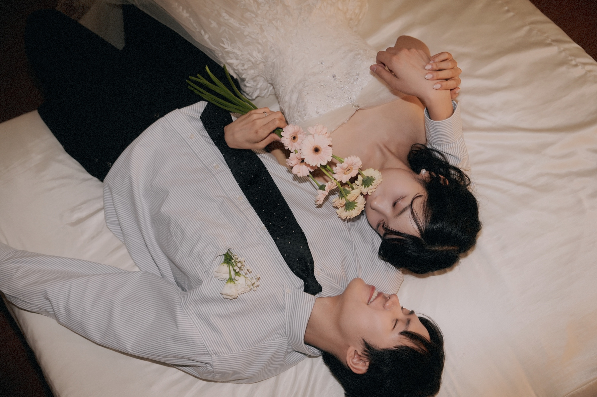

# 🍑 준혁 & 미미 — 웨딩피치 MB-3 감성 모바일 청첩장

- 주소: https://mimipark97.github.io/wedding/peach/
- 기존 청첩장(`/wedding/invite/`)은 그대로 두고, 별도 폴더로 추가했습니다.

## 구성

| 경로 | 내용 |
|---|---|
| `index.html` | 완성본 (웹폰트 base64 내장 · 이 파일 하나로 열림) |
| `images/` | 사진 22장(10번·18번 제외) + 히어로 1장 + 약도 + 아기 사진 스티커(webp) + 종이 텍스처 2장 |
| `audio/bgm.mp3` | 배경음악 (기존 청첩장과 동일한 곡) |

## 손보는 곳

### 부모님(가족) 사진 넣기
`index.html`에서 `images/gallery-01.jpg` 를 쓰는 `figure.ph.ph-a` 한 곳입니다.

```html
<!-- [부모님 사진 자리] 아래 img 의 src 를 양가 부모님(또는 가족) 사진으로 바꾸면
     이 자리에 그대로 들어갑니다. 세로 사진이 가장 잘 맞습니다. -->
<figure class="ph ph-a">
  
  <figcaption>just us</figcaption>
</figure>
```

- 사진을 `peach/images/parents.jpg` 로 올리고 `src="images/parents.jpg"` 로 바꾸면 끝입니다.
- 아기 사진 스티커(`images/sticker-groom.webp`, `images/sticker-bride.webp`)은 그대로 두면 됩니다.

### 아기 사진 바꾸기
`downloads/baby-demo/` 의 원본을 흰 배경 제거 + 외곽선 스티커로 만든 파일입니다.
원본을 바꾸려면 작업 폴더 `/workspace/work/peach-build/gen_assets.py` 의 `make_sticker()` 를 다시 돌리면 같은 모양으로 다시 만들어집니다(핫핑크 = `(255,46,111)`, 피치 = `(255,138,76)`).

### 문구·계좌·연락처
`index.html` 안에서 그대로 검색해 고치면 됩니다. 계좌 6건 · 전화 2건은 기존 청첩장 값과 동일합니다.

## 원본 소스
편집용 원본은 `/workspace/work/peach/index.src.html` (폰트는 `fonts/` 파일 참조)이고,
`python3 /workspace/work/peach-build/build.py` 로 폰트를 내장해 `index.html` 을 다시 만듭니다.
